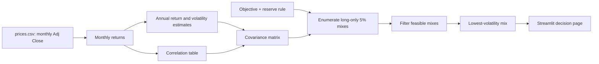

# Lab 15 — Portfolio Stability Decision

## Decision question

Which long-only 5%-step mix has the lowest estimated volatility while meeting Meridian's 6.5% annual expected-return objective and 3% reserve rule, and does that answer survive a one-point estimate change?

This is a learning demonstration built with AI help, not investment advice. All return figures below are historical estimates, not forecasts.

## Engine and app

`portfolio.py` preserves Lab 14's original console output and adds two reusable functions:

- `search_lowest_risk_mix()` enumerates every long-only mix in 5-point increments, filters for the return objective and reserve minimum, and retains the feasible mix with the lowest volatility.
- `estimate_from_csv()` reads monthly adjusted-close prices, converts adjacent prices to monthly returns, annualizes arithmetic mean return by multiplying by 12 and sample standard deviation by multiplying by √12, then calculates correlations.

`app.py` imports these functions and the Meridian inputs. It does not keep a second copy of portfolio mathematics. Its sidebar contains the objective, reserve minimum, CSV upload, and last-36-month switch. The page permits each expected-return estimate to be edited, checks reserve eligibility by asset, and compares the answer as loaded with the edited-estimate answer.

The app also includes an optional market-data panel for an informational LLY intraday-price check and a direct link to the Yahoo Finance LLY quote page. It first requests Yahoo Finance and, if Yahoo is temporarily rate-limited or unavailable, transparently falls back to Nasdaq's public quote endpoint. That panel is intentionally not an optimizer input: its data can be delayed or unavailable, while the lab's dated monthly adjusted-close `prices.csv` preserves reproducible estimates and results.

Run from this folder:

```powershell
python portfolio.py
python -m unittest -v test_lab15.py
streamlit run app.py
```



## Meridian training validation

| Run | Bills | 10-year | IG | Equity | Return | Volatility | Reserve-eligible |
|---|---:|---:|---:|---:|---:|---:|---:|
| As loaded | 0% | 20% | 25% | 55% | 6.51% | 9.44% | 20% |
| Equity estimate edited from 8.0% to 7.0% | 0% | 10% | 10% | 80% | 6.53% | 12.94% | 10% |

The largest training-run weight change is **25 points**: equity rises from 55% to 80% after its expected-return estimate is lowered by one point. This is a discrete-search result: with less return credited to equity, the optimizer must hold more equity to clear the 6.5% objective, even though that raises estimated volatility.

To verify that the app uses the engine rather than a copied answer, I changed both IG–equity correlation cells from 0.25 to 0.50. The engine and app answer became **0% / 40% / 0% / 60%**, with **6.52%** expected return and **9.73%** volatility. I then restored the original 0.25 correlations.

## Fund universe, data, and mandate

My Project 2 company focus remains Eli Lilly (`LLY`), but LLY is a comparison series rather than a portfolio sleeve. The investable fund universe contains five diversified funds. `prices.csv` has monthly adjusted-close prices, oldest month first, covering five years through the October 19, 2026 market close. Adjusted close is used because it reflects distributions.

| Ticker | Fund | Portfolio role | Reserve-eligible? |
|---|---|---|---|
| BIL | SPDR Bloomberg 1-3 Month T-Bill ETF | cash/reserve | Yes |
| IEF | iShares 7-10 Year Treasury Bond ETF | government bond | Yes |
| LQD | iShares iBoxx USD Investment Grade Corporate Bond ETF | investment-grade fixed income | No |
| VTI | Vanguard Total Stock Market ETF | broad U.S. equity | No |
| XLV | Health Care Select Sector SPDR Fund | healthcare equity comparison | No |

The mandate inputs used in the app are the established Meridian objective of **6.5% estimated annual return** (CPI estimate 2.5% + 4.0%) and the **3%** reserve minimum. BIL and IEF are checked as reserve-eligible because both are U.S. government securities and are used here as the liquid reserve sleeve. The mandate's calendar-year loss statement still needs the CIO's operational definition, so it is not silently coded as an optimizer constraint.

Source and download date: Yahoo Finance historical-price data, downloaded October 20, 2026; the exact values used are preserved in `prices.csv`. Course inputs and requirements are preserved in `lab-15-portfolio-stability.md` (accessed October 22, 2026).

## My-universe stability results

The application calculated estimates from `prices.csv` and used the 6.5% objective and 3% reserve minimum. LLY was excluded from the search because it is the company-focus comparison series, not an investable fund sleeve.

| Estimation window | BIL | IEF | LQD | VTI | XLV | Estimated return | Estimated volatility | Reserve-eligible |
|---|---:|---:|---:|---:|---:|---:|---:|---:|
| All available monthly returns | 65% | 0% | 0% | 30% | 5% | 6.56% | 5.27% | 65% |
| Last 36 monthly returns | 85% | 0% | 0% | 10% | 5% | 6.57% | 1.69% | 85% |

The largest change between the two estimation windows is **20 points**: BIL rises from 65% to 85% and VTI falls from 30% to 10%. The return objective is not lowered to create a result. The sharp fall in estimated volatility for the recent-window answer is a warning about estimation uncertainty, especially because the 36-month window is shorter and includes a different rate/equity environment.

## Partner Q&A and attack response

**Q: Why can a one-point lower equity estimate lead to more equity instead of less?**

**A:** The search is constrained to meet 6.5% expected return. When equity's estimate falls from 8% to 7%, more equity is required to reach that target; within the 5% grid, the lowest-risk feasible mix shifts from 55% to 80% equity. The counterintuitive shift is exactly why the result is a decision aid rather than a recommendation.

**Q: Why did the all-history and last-36-month answers move by 20 points?**

**A:** The estimates come from different samples. The all-history window assigns a different combination of average returns, volatilities, and co-movements than the recent-only window, so the lowest-risk feasible grid point changes from 65% BIL/30% VTI/5% XLV to 85% BIL/10% VTI/5% XLV. Both answers should be read as estimates, not as stable predictions.

**Q: Which estimate is most fragile in this universe, and what happened when it was stressed?**

**A:** VTI's expected return is central because it supplies much of the return above BIL; lowering its all-history estimate by one point, from 12.36% to 11.36%, changed the answer to 60% BIL / 0% IEF / 0% LQD / 30% VTI / 10% XLV, with 6.52% estimated return and 5.77% volatility. The largest change was 5 points, so this grid is less sensitive to that single stress than the Meridian training case but remains estimation-dependent.

## Estimation risk and my call

Estimation risk is the chance that inputs inferred from historical data differ from future returns, risks, and correlations. An optimizer amplifies small expected-return errors because it treats each estimate as a precise hurdle: a small change can make one nearby 5%-grid mix infeasible and another mix the new winner. Meridian's 25-point change makes that visible.

**My call: pilot, not adopt.** The all-history answer is a transparent starting allocation because it meets the stated objective and reserve rule, but I would not adopt it as a durable allocation without a CIO decision that operationalizes the calendar-year loss limit and a review of forward-looking return assumptions. I would change the call to adopt only after the CIO defines S9 (return measure, observation date, and breach response) and the mix remains acceptable under that downside constraint and several plausible return/correlation stresses.

## Submission contents

- `Lab_15_Submission.md` — this analysis and decision record.
- `portfolio.py` — Lab 14 engine plus search and CSV-estimation functions.
- `app.py` — Streamlit interface using the engine.
- `test_lab15.py` — checks for both Meridian answers, engine linkage, and the CSV path.
- `prices.csv` — input data used for the fund-universe calculations.
- `lab-15-portfolio-stability.md` — saved course instructions used for this submission.
